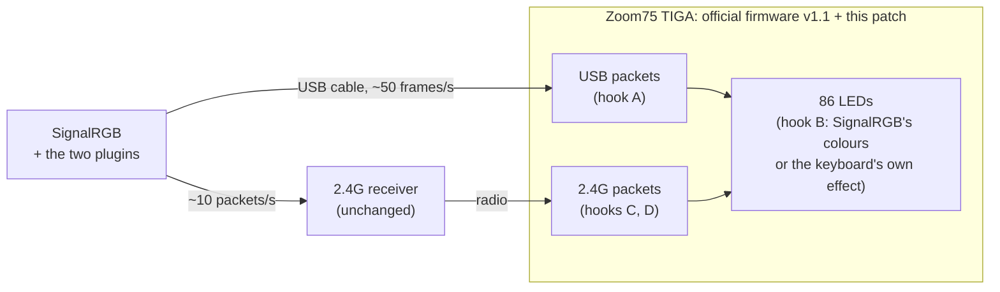

<div align="center">

# Zoom75 TIGA × SignalRGB

**Per-key SignalRGB lighting for the Meletrix Zoom75 TIGA, over the USB cable and the 2.4G receiver.**

A small, verified patch for the official firmware v1.1, and two SignalRGB plugins.

[](LICENSE)


[](https://buymeacoffee.com/Iwky)

</div>

> [!NOTE]
> Community project by Iwky. **Meletrix has agreed to distribute the SignalRGB plugins
> officially**, so SignalRGB shows Meletrix as their publisher.

> [!WARNING]
> Flashing modified firmware is at your own risk: read [Flashing and safety](docs/flashing.md)
> first. This repository does not contain Meletrix's firmware, only the patch.

## Features

- **All 86 LEDs under SignalRGB's control**, with the key layout SignalRGB needs.
- **On the USB cable:** smooth, about 50 frames per second.
- **Wireless, through the 2.4G receiver:** works too. The receiver link is slow, so it suits
  static and slow scenes best.
- **Nothing else changes:** VIA, the Meletrix Console, Bluetooth and 2.4G typing, the LCD, the
  knob and the built-in effects work as before. When SignalRGB stops, the keyboard returns to
  its own effect within 2 seconds.
- **No compiler needed:** one Python script turns the official firmware into the patched
  one, byte for byte the build that was tested.
- **Verified:** static checks, about 50,000 emulator checks of the real patch bytes, and tests
  on a real keyboard ([results](docs/hardware-results.md)).

## Compatibility

| | |
|---|---|
| Keyboard | Meletrix **Zoom75 TIGA** |
| Firmware | the official **v1.1** only (`WQ206B1UBTG2_V10_3424_KB81_RGB_LCD_SV3.0.0_20250412.hex`, SHA-256 `678ec144…5d4b`). The scripts refuse any other file. |
| Connections | USB cable ✅ · 2.4G receiver ✅ · Bluetooth ❌ |
| Software | Windows, SignalRGB (tested with 2.5.80), Python 3 (to make the patched file) |

## How it works



The stock firmware is a vendor build of QMK. The patch adds about 1 KB of code in unused
flash and redirects four call instructions to it. That code answers SignalRGB's commands
(the [SRGBmods QMK protocol](https://github.com/SRGBmods) 1.0.6) and passes everything else
on unchanged. More: [docs/development.md](docs/development.md#how-the-patch-works).

## Quick start

1. **Get the official firmware v1.1** for the Zoom75 TIGA and Meletrix's flashing tool
   `WuqueDFUupgradeProgrammer` from the
   [Wuque Studio / Meletrix Resource Library](https://wuque-studio.notion.site/Wuque-Studio-Meletrix-Resource-Library-e1aec540606e483f898779c25239be40)
   (details and the direct link: [flashing.md](docs/flashing.md#1-get-the-official-firmware)).
2. **Make the patched firmware** in a clone of this repository:

   ```bash
   python apply_patch_v2.py WQ206B1UBTG2_V10_3424_KB81_RGB_LCD_SV3.0.0_20250412.hex
   ```

   It writes `patched_v2.hex` only if the result is exactly the tested build (SHA-256
   `1f1f1c469d437d6d8626d9f667e32f0788b4798807b25c71fe8524f4772fe59d`).
3. **Flash it** with the Wuque tool's normal upgrade: [flashing.md](docs/flashing.md#3-flash-it).
4. **Install both plugins** from [`plugin/`](plugin) into SignalRGB:
   [signalrgb.md](docs/signalrgb.md#install).

To go back to stock, flash the official hex the same way.

## Using 2.4G

- Unplug the cable and press **Fn+V**. **After every cable plug or unplug, press Fn+V
  again**: plugging in switches the keyboard to USB mode, and unplugging doesn't switch it back.
- Expect about one full-board refresh per second: a single key changes within about 0.2 s,
  a whole new scene sweeps across in about 1 s.
- While SignalRGB streams over 2.4G the keyboard doesn't go to sleep, so it uses battery the
  whole time. Use the cable, or close SignalRGB, to save battery.

More, and troubleshooting: [docs/signalrgb.md](docs/signalrgb.md).

## Documentation

| | |
|---|---|
| [Flashing and safety](docs/flashing.md) | official firmware, patching, flashing, going back, recovery |
| [SignalRGB](docs/signalrgb.md) | plugins, cable and 2.4G use, troubleshooting, known limits |
| [Hardware results](docs/hardware-results.md) | what was tested on a real keyboard |
| [Development](docs/development.md) | building, verifying, testing, the repository layout |
| [Engineering record](docs/README.md#engineering-record) | the full analysis and design documents |

## FAQ

**Can I go back to the stock firmware?** Yes: flash the official v1.1 hex with the same tool.
The patch keeps no settings.

**Does VIA still work?** Yes. The patch passes every VIA and Meletrix Console command through
unchanged (checked on the keyboard with patch v1, and for patch v2 in the emulator). Close
SignalRGB while VIA or the Console is open: they all use the same interface.

**Why is 2.4G slower than the cable?** The receiver passes about one packet every 80–100 ms,
and a full frame is 10 packets. The 2.4G plugin sends only what changed.

**Other Meletrix keyboards, or other firmware versions?** No. The patch addresses fit only
this exact build, and the scripts refuse anything else.

**Bluetooth?** No. In Bluetooth mode the keyboard shows its own effect.

## Support

If this project helped you, you can buy me a coffee:

[](https://buymeacoffee.com/Iwky)

## License and credits

- This project's code and documents: **GPL-2.0**, see [LICENSE](LICENSE). The SignalRGB
  plugins started from SRGBmods' plugin template
  ([SRGBmods/qmk-plugins](https://github.com/SRGBmods/qmk-plugins), GPL-2.0), and the firmware
  patch implements SRGBmods' QMK protocol 1.0.6.
- The plugins name **Meletrix** as their publisher, with Meletrix's agreement.
- **Not included and not covered by this license:** Meletrix's firmware and tools. The patch
  is applied to the official firmware you download yourself.
- Meletrix, Zoom75 TIGA, Wuque Studio, SignalRGB and VIA are trademarks of their owners.
